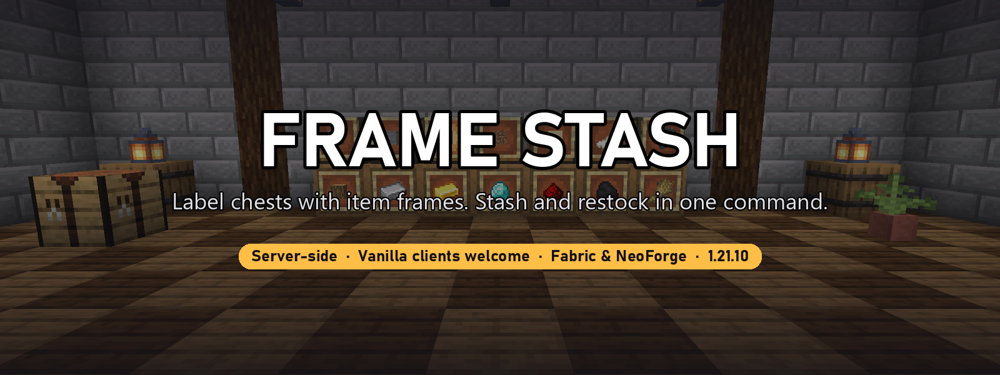
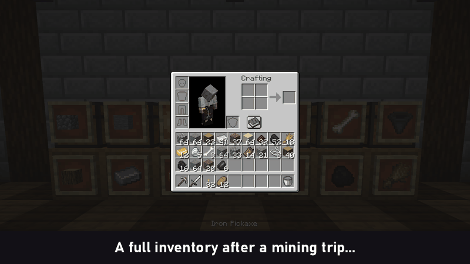

# Frame Stash

Label chests with item frames, then quick stack, restock and overflow into them. Server-side; vanilla clients can join.

Minecraft 1.21.10 · Fabric and NeoForge · MIT licence · [How to test it yourself](TESTING.md)



## How it works

1. Put an item frame on a chest, trapped chest, barrel or placed shulker box.
2. Put an item in the frame. That item is the label.
3. Run `/stash` near your labelled containers. Every matching item in your main inventory moves into the nearest container labelled for it.

- **Overflow:** a *glow* item frame marks an overflow container. It is used only once every normal-frame container for that item is full.
- **Catch-all:** a frame holding a **Hopper** marks a leftover bin for items with no room anywhere else.
- **Restock:** `/restock` tops up partial stacks in your hotbar and inventory from containers labelled for that item.
- A frame on either half of a double chest labels the whole chest. Several frames on one container mean it accepts all of those items.
- Labels match by item type. Items are only merged into stacks that are exactly the same, so renamed or enchanted items never get mixed.

## Menu

`/framestash` opens a chest-style menu. It uses the vanilla chest screen, so it works for players without the mod.

- **Stash** and **Restock** buttons, with the result shown at the top
- **Nearby containers:** every labelled container in range with its labels, how full it is, and why it's skipped if it is. Click one to draw a particle trail to it.
- **How to label** and **Overflow and catch-all** cards
- **Your own toggles:** stash hotbar, sound, particles. They're saved per world in `frame_stash_players.json`. Players can turn sound and particles off but not on against the server config.
- **Reload config** button for operators

Every click is cancelled on the server, so icons can't be taken and nothing can be moved through the menu.

## Commands

| Command | Who (default) | What |
| --- | --- | --- |
| `/framestash` | everyone | Open the menu |
| `/stash` | everyone | Quick stack into labelled containers in range |
| `/restock` | everyone | Top up partial stacks from labelled containers |
| `/framestash info` | everyone | List the labelled containers in range, what each accepts, and why any are skipped |
| `/framestash reload` | ops (level 2) | Reload `frame_stash.toml` |

Optional gesture (off by default): sneak and right-click a labelled container with an empty hand to stash.

## Config: `config/frame_stash.toml`

| Key | Default | Purpose |
| --- | --- | --- |
| radius | 16 | Search distance in blocks, 4 to 32 |
| maxContainers | 64 | Cap on containers touched per action |
| includeHotbar | false | Whether Stash may move hotbar items |
| restockEnabled | true | Turns Restock on or off |
| overflowEnabled | true | Glow frames mean overflow; when off they count as normal labels |
| catchAllItem | "minecraft:hopper" | Item in a frame that marks the catch-all; `""` disables it |
| cooldownTicks | 20 | Minimum time between actions per player |
| particles, sound, actionBar | true | Feedback toggles; with actionBar off, the summary goes to chat |
| commandPermissionLevel | 0 | Who may use /stash, /restock and /framestash info |
| skipBlockedChests | true | Skip chests vanilla would refuse to open (solid block or cat on top) |
| protectionCheck | true | Ask claim/protection mods before touching a container |
| sneakGesture | false | Enable the sneak-right-click gesture |

Allowed container blocks come from the block tag `frame_stash:containers`. Data packs can add to it.

## Compatibility

- **Vanilla clients:** no client code, no packets, no registries. All text is literal, so clients without the mod see it correctly.
- **Locked containers** (vanilla lock component) are always skipped. **Spawn protection and the world border** are always respected.
- **Claim mods, Fabric:** checked through the bundled [Common Protection API](https://github.com/Patbox/common-protection-api), which Flan, GOML, Open Parties and Claims and others implement.
- **Claim mods, NeoForge:** checked by posting a simulated empty-hand `PlayerInteractEvent.RightClickBlock` and reading whether a mod cancelled it. That covers FTB Chunks, Open Parties and Claims and others. If a mod reacts badly to the probe, set `protectionCheck = false`.
- **Bigger stacks:** limits always come from the container's and the item's own `getMaxStackSize`, never a fixed 64. Mods or data packs that raise stack sizes are respected, both through the `max_stack_size` component and through mods that patch container limits. Totals are counted as `long`, so huge stacks cannot overflow them.

## Layout

| Module | Contents |
| --- | --- |
| `common` | All game logic, compiled against vanilla Minecraft (Mojang mappings via NeoForm) |
| `fabric` | Fabric entrypoint, Common Protection API hook, unit tests (`src/test`) and in-world GameTests (`src/gametest`, dev only, not shipped) |
| `neoforge` | NeoForge mod class and event-based protection hook |

The loader modules compile the `common` sources into their own jars, so each loader ships one jar with no extra dependency.

## Build, test and run

Requires a JDK 21 or newer; Gradle downloads a Java 21 toolchain if needed.

```sh
./gradlew build                     # compiles, runs unit tests, jars in fabric/build/libs and neoforge/build/libs
./gradlew :fabric:test              # planner and config tests, including the 50-run item-totals test
./gradlew :fabric:runGameTest       # in-world tests: real chests, frames and a mock player (11 tests)
./gradlew :fabric:runServer         # dedicated Fabric server (fabric/run-server)
./gradlew :neoforge:runServer       # dedicated NeoForge server (neoforge/run-server)
./gradlew :fabric:runClient         # dev client
./gradlew :neoforge:runClient
```

The first server run creates `run-server/eula.txt`. Set `eula=true` there to accept Minecraft's EULA.

Release jars are named `frame-stash-<loader>-<minecraft>-<version>.jar`, for example `frame-stash-fabric-1.21.10-1.0.0.jar`.

## Licence

MIT, see [LICENSE](LICENSE).

## Targets

Minecraft 1.21.10, Java 21, Fabric Loader 0.17.3 + Fabric API 0.138.4, NeoForge 21.10.64.
