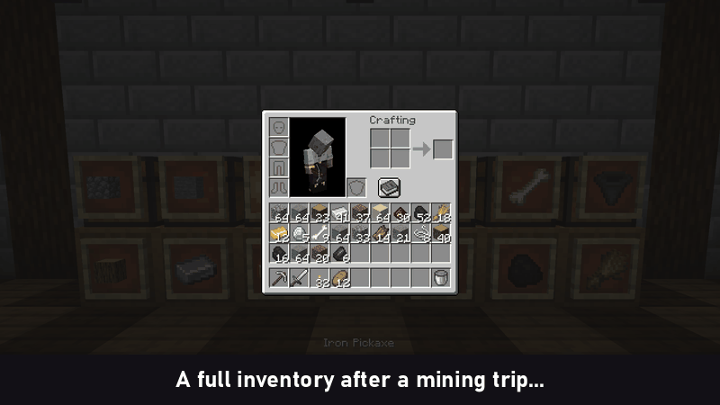
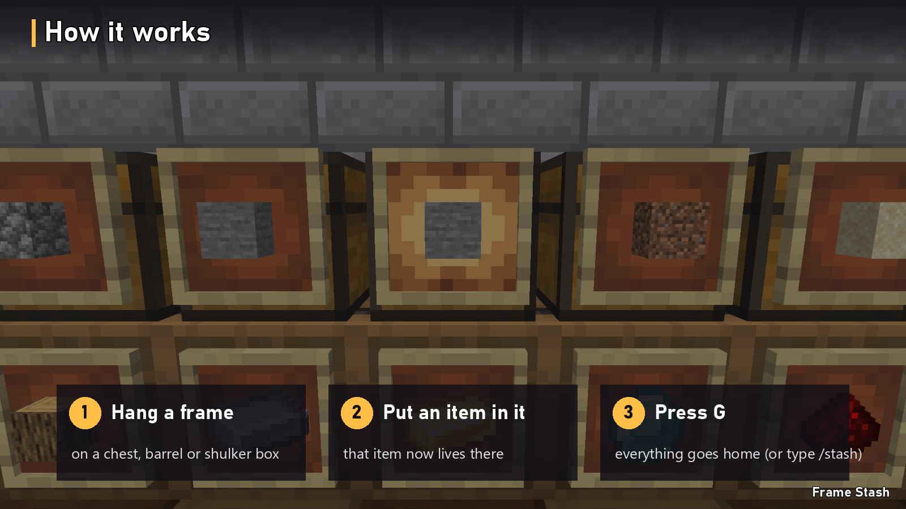
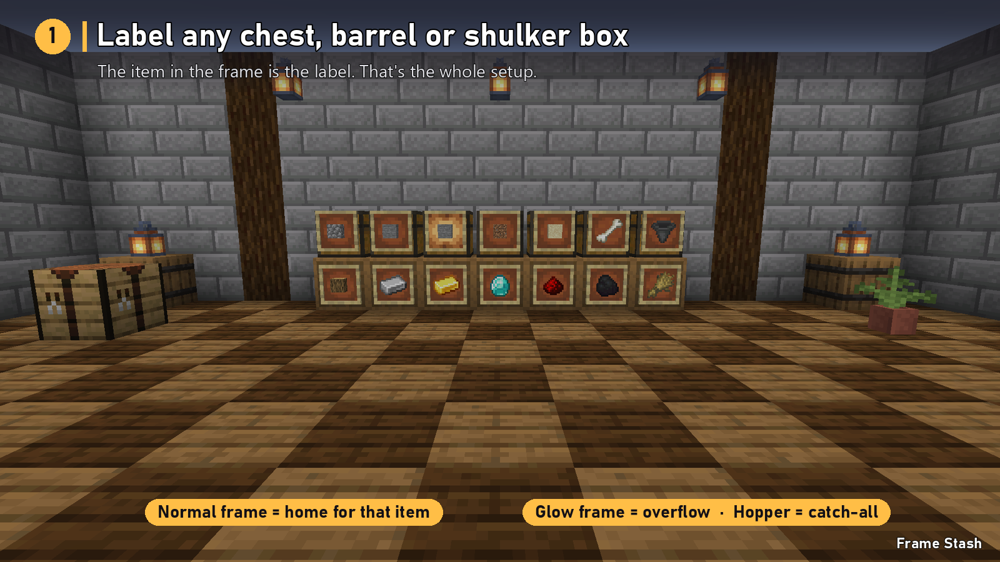
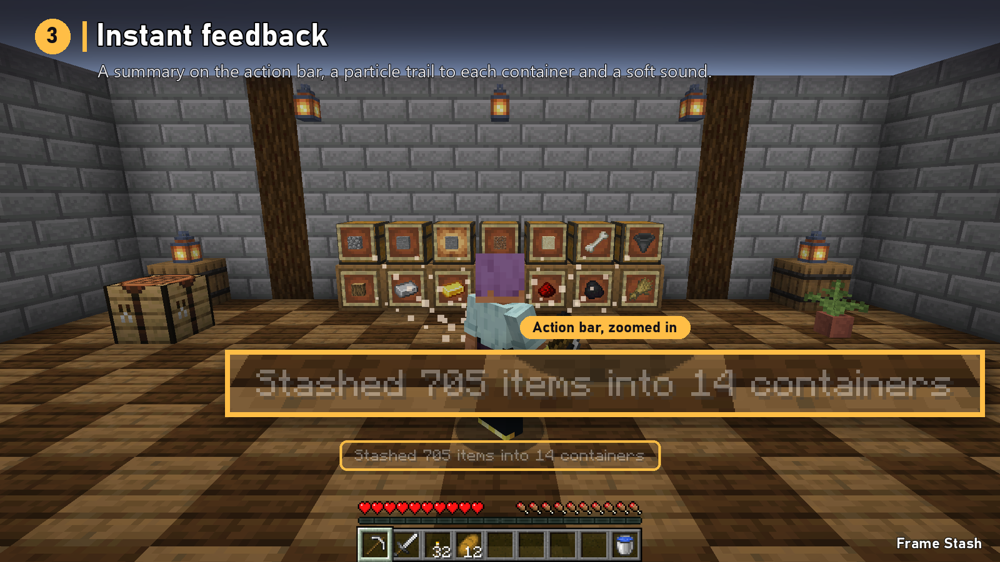
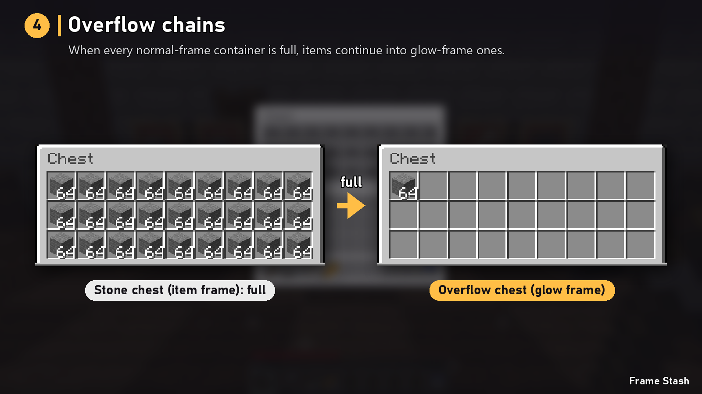

## Your storage, sorted with one key

You already hang item frames on your chests so you know what's inside. **Frame Stash makes those frames work.**

Come back from a mining trip, press **G**, and every item in your inventory goes to the chest whose frame shows it: cobblestone to the cobblestone chest, iron to the iron chest, logs to the log chest. Running low on torches? Press **H** and your stacks fill back up from the same chests.

No new blocks, no new items, no setup screens. Just vanilla item frames on vanilla chests.

---

## How it works

1. **Hang an item frame** on a chest, trapped chest, barrel or shulker box.
2. **Put an item in the frame.** That container is now its home.
3. **Press G** near your storage. Everything with a home goes home.

## Controls

| Key | What it does |
| --- | --- |
| **G** | **Stash.** Sends every item that has a labelled home into its container |
| **H** | **Restock.** Tops up partial stacks (torches, food, blocks, arrows) from your labelled containers |
| *(set your own)* | **Open the Frame Stash menu** |

- **G and H also work with your inventory or a chest open.** Quick-stack without closing the screen.
- Change them under **Options → Controls → Key Binds → Frame Stash**.
- Your **hotbar, armour and offhand are never touched** unless you allow the hotbar in the menu.

---

## Features

### Any item frame is a label

- **One frame, one label.** Hang several frames on a container and it accepts all of those items.
- **Double chests just work.** A frame on either half labels the whole chest.
- **Nearest first.** Items go to the closest matching container in range.
- **No mixing.** Items only stack onto identical items, so your renamed or enchanted gear stays separate.

### One key empties your inventory

Only items that have a home move. Everything else stays in your inventory, so nothing ends up somewhere you didn't plan.

### See where everything went

A short summary on your action bar ("Stashed 705 items into 14 containers"), a particle trail to every container that received something, and a soft sound. Each one can be turned off.

### Overflow chests and a catch-all

- **Glow item frame = overflow.** When every normal-frame chest for an item is full, the rest goes into glow-frame chests. No more "chest full" surprises after a big mining trip.
- **Hopper in a frame = catch-all.** Anything with nowhere else to go lands here instead of staying in your inventory.

### The Frame Stash menu

Open it with your menu key or `/framestash`:

- **Stash** and **Restock** buttons
- **Nearby containers:** every labelled container around you, with its labels, how full it is, and a warning if it can't be used. Click one and a particle trail shows you the way.
- **Your own settings:** include the hotbar, sound, particles

---

## Installing

| Where | Needed? | What you get |
| --- | --- | --- |
| **Server** (or singleplayer) | **Required** | Stashing, restocking, the menu |
| **Your client** | Recommended | The **G** and **H** keybinds |

Fabric needs [Fabric API](https://modrinth.com/mod/fabric-api). NeoForge needs nothing else. Check the **Files** tab for the Minecraft versions each file supports.

**Playing on a server where you don't have the mod installed?** Everything still works through commands and the menu:

| Command | Same as |
| --- | --- |
| `/stash` | G |
| `/restock` | H |
| `/framestash` | Menu key |
| `/framestash info` | Lists labelled containers nearby |

---

## For server owners

- **Respects protection.** Locked chests, claimed or protected areas, spawn protection and chests blocked by a block on top are skipped. Fabric claim mods are asked through the bundled Common Protection API, NeoForge ones through the standard interaction event.
- **Safe by design.** Every stash is planned first and then applied with fresh checks, so items are never lost or duplicated, even when several players use the same chests.
- **Light on performance.** Nothing runs in the background; work happens only when someone presses the key.
- **Bigger stacks friendly.** Stack limits come from the item and the container, never a fixed 64, so stack-size mods and data packs just work.
- **Configurable.** `config/frame_stash.toml`, reloaded in game with `/framestash reload`. Add more container blocks with the block tag `frame_stash:containers`.

| Setting | Default | What it does |
| --- | --- | --- |
| `radius` | 16 | How far to look for labelled containers (4 to 32 blocks) |
| `maxContainers` | 64 | Most containers used by one stash |
| `includeHotbar` | false | Default for taking hotbar items (each player can change their own in the menu) |
| `restockEnabled` | true | Turns restocking on or off |
| `overflowEnabled` | true | Glow frames mean overflow. When off, they act like normal frames |
| `catchAllItem` | `"minecraft:hopper"` | Item that marks a catch-all. `""` turns it off |
| `cooldownTicks` | 20 | Minimum time between stashes per player |
| `particles`, `sound`, `actionBar` | true | Feedback toggles |
| `commandPermissionLevel` | 0 | Who can stash, restock and open the menu (0 = everyone) |
| `skipBlockedChests` | true | Skip chests vanilla wouldn't open |
| `protectionCheck` | true | Ask claim and protection mods before using a container |
| `sneakGesture` | false | Sneak and right-click a labelled container with an empty hand to stash |

---

## FAQ

**Do I have to install it on my client?**
Only if you want the keybinds. The server does all the work. Without the client install you use `/stash`, `/restock` and `/framestash` instead.

**Will it put items in my locked or claimed chests?**
No. Anything you couldn't open yourself is skipped.

**What are glow item frames for?**
Overflow. A glow-frame chest is only used once every normal-frame chest for that item is full.

**Will it grab my tools and food?**
No. Your hotbar, armour and offhand are left alone by default, and only items with a labelled home (or a catch-all) move at all.

**Does it sort the inside of my chests?**
No. It moves items between you and your chests; it doesn't rearrange what's already inside.

**Can I use it in a modpack?**
Yes. Frame Stash is MIT licensed.

---

[Source code](https://github.com/marso006/frame-stash) · [Report a bug or suggest a feature](https://github.com/marso006/frame-stash/issues) · MIT License
