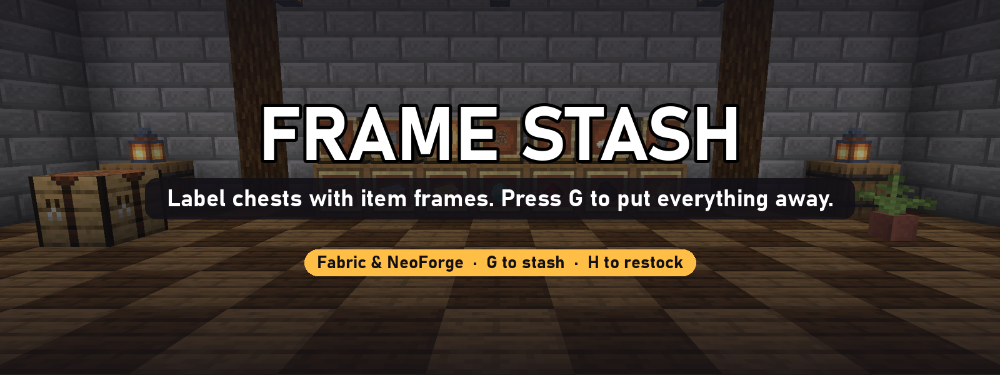
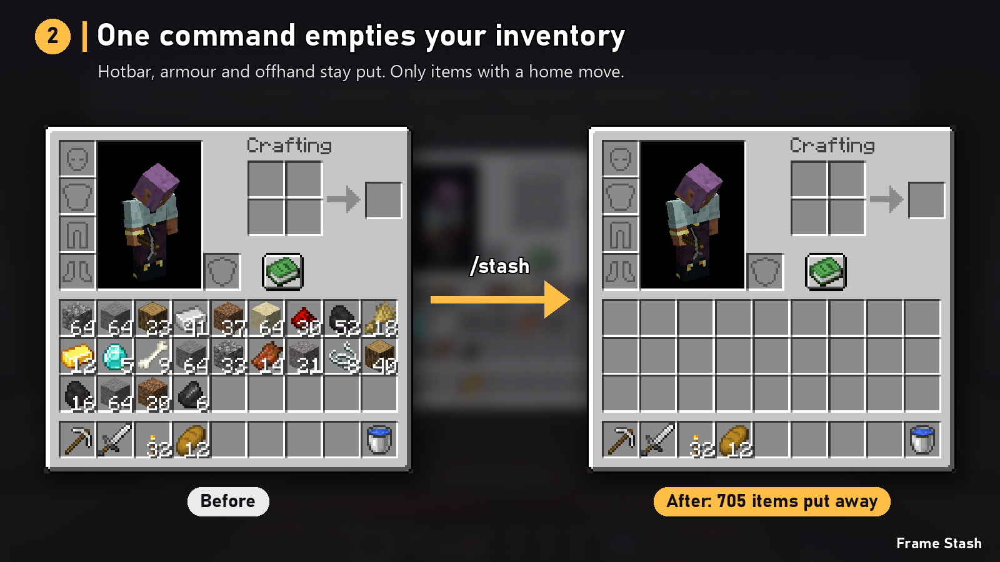
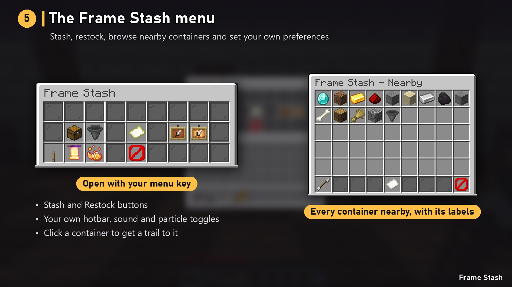

**Label your chests with item frames. Put everything away with one command.**

Frame Stash turns the item frames you already hang on your storage into real labels. Come home from a mining trip, type `/stash`, and every item in your inventory goes to the chest whose frame shows it. Need more torches? `/restock` tops your stacks back up from the same chests.

It runs **on the server**. Players join with an unmodded client and still get everything, including the menu. Install it on your client too and you also get **keybinds**: press **G** to stash, even with a chest open.

---

## How it works

1. **Hang an item frame** on a chest, trapped chest, barrel or placed shulker box.
2. **Put an item in the frame.** That item now lives in that container.
3. **Type `/stash`** near your storage, or open the menu with `/framestash`.

No new blocks, no new items, no setup. If you remove the mod, your frames and chests are still just frames and chests.

---

## Features

### Label anything with a vanilla item frame

- One frame, one label. Put several frames on a container and it accepts all of those items.
- A frame on either half of a **double chest** labels the whole chest.
- Matching is by item type. Items only merge into identical stacks, so renamed or enchanted items never get mixed.

### One command empties your inventory

Items go to the **nearest** matching container first. Your **hotbar, armour and offhand stay where they are** unless you turn the hotbar on in the menu.

### Instant feedback

A short summary on the action bar ("Stashed 705 items into 14 containers"), a particle trail to every container that received something, and a soft sound. Each one can be turned off.

### Overflow chains and a catch-all

- **Glow item frame = overflow.** Once every normal-frame container for an item is full, items continue into glow-frame containers.
- **Hopper in a frame = catch-all.** Anything with nowhere else to go ends up there. The marker item can be changed in the config.

### Restock

`/restock` tops up every partial stack in your hotbar and inventory from the containers labelled for that item, nearest first. Perfect for torches, food, building blocks and arrows.

### A menu that works without a client mod

`/framestash` opens a menu built from a normal chest screen, so unmodded clients can use it:

- **Stash** and **Restock** buttons
- **Nearby containers**: every labelled container around you, with its labels, how full it is, and why it's skipped if it is. Click one to get a particle trail to it.
- **Your own settings**: stash hotbar, sound and particles. They're saved per player.
- **Reload config** button for operators

---

## Commands

| Command | Default permission | What it does |
| --- | --- | --- |
| `/stash` | everyone | Put matching items away into labelled containers in range |
| `/restock` | everyone | Top up partial stacks from labelled containers |
| `/framestash` | everyone | Open the menu |
| `/framestash info` | everyone | List labelled containers in range and what each accepts |
| `/framestash reload` | operators | Reload the config |

### Keybinds (optional client install)

If you also put Frame Stash in your own `mods` folder, you get keybinds. Change them under **Options → Controls → Key Binds → Frame Stash**.

| Key | Action |
| --- | --- |
| **G** | Stash. Works in the world **and with your inventory or a chest open** |
| **H** | Restock |
| *(unbound)* | Open the menu |

The keys simply run the commands, so they work on any server with Frame Stash, and players without the client install lose nothing.

Optional, off by default: **sneak and right-click** a labelled container with an empty hand to stash.

## Configuration

`config/frame_stash.toml` is created on first start. Run `/framestash reload` after editing.

| Setting | Default | What it does |
| --- | --- | --- |
| `radius` | 16 | How far to look for labelled containers (4 to 32 blocks) |
| `maxContainers` | 64 | Most containers touched by one action |
| `includeHotbar` | false | Default for whether `/stash` takes hotbar items (players can change their own in the menu) |
| `restockEnabled` | true | Turns `/restock` on or off |
| `overflowEnabled` | true | Glow frames mean overflow. When off, they act like normal frames |
| `catchAllItem` | `"minecraft:hopper"` | Item that marks a catch-all. `""` turns it off |
| `cooldownTicks` | 20 | Minimum time between actions per player |
| `particles`, `sound`, `actionBar` | true | Feedback toggles |
| `commandPermissionLevel` | 0 | Who can use `/stash`, `/restock` and the menu (0 = everyone) |
| `skipBlockedChests` | true | Skip chests vanilla wouldn't open, for example with a block on top |
| `protectionCheck` | true | Ask claim and protection mods before touching a container |
| `sneakGesture` | false | Enable sneak + right-click to stash |

Server owners and modpack makers can add more container blocks through the block tag `frame_stash:containers`.

---

## Compatibility

- **Minecraft 1.21.10** on **Fabric** (needs Fabric API) and **NeoForge**
- **Required on the server, optional on the client.** Players without it can use everything through commands and the menu. Players with it also get keybinds. It works in singleplayer too.
- **Claim and protection mods:** a container is skipped if you couldn't open it yourself. On Fabric this goes through the bundled Common Protection API; on NeoForge through the standard block-interaction event.
- **Locked containers, spawn protection and the world border** are always respected.
- **Bigger stack mods:** stack limits always come from the container and the item, never a fixed 64, so mods and data packs that raise stack sizes just work.
- **Safe by design:** every action is planned first, then applied with fresh checks, so items are never lost or duplicated, even with two players stashing into the same chests.

## FAQ

**Do players need to install anything?**
No. Everything, including the menu, works with an unmodded client. Installing it on the client only adds keybinds (G to stash, H to restock).

**Will it put things into my locked chests?**
No. Locked chests, chests with a block on top, protected chests and chests in unloaded chunks are skipped.

**What are glow item frames for?**
Overflow. A glow-frame container is only used once every normal-frame container for that item is full.

**Can I keep my tools out of the stash?**
Yes. The hotbar is never touched unless you turn it on, and only items with a labelled home (or a catch-all) move at all.

**Does it sort the inside of my chests?**
No. Frame Stash moves items between your inventory and your containers. It doesn't rearrange what's already inside.

**Can I use it in a modpack?**
Yes. Frame Stash is MIT licensed.

---

[Source code](https://github.com/marso006/frame-stash) · [Report a bug](https://github.com/marso006/frame-stash/issues) · MIT License
